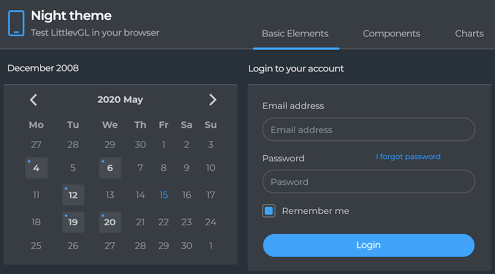
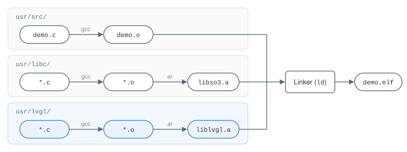
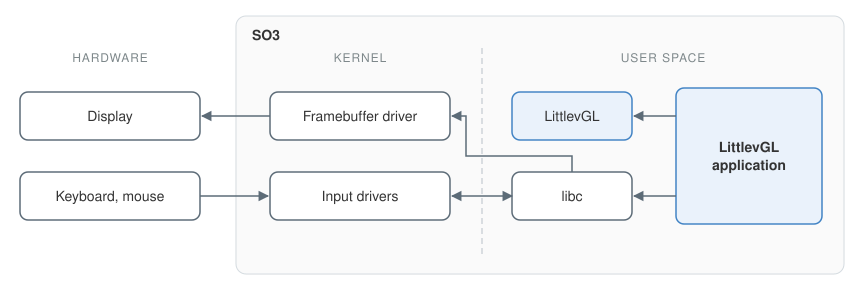
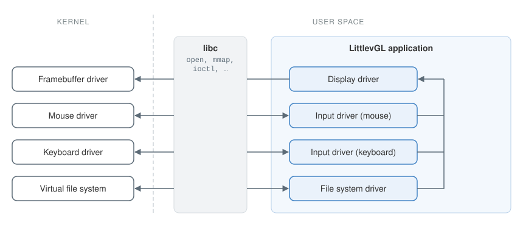
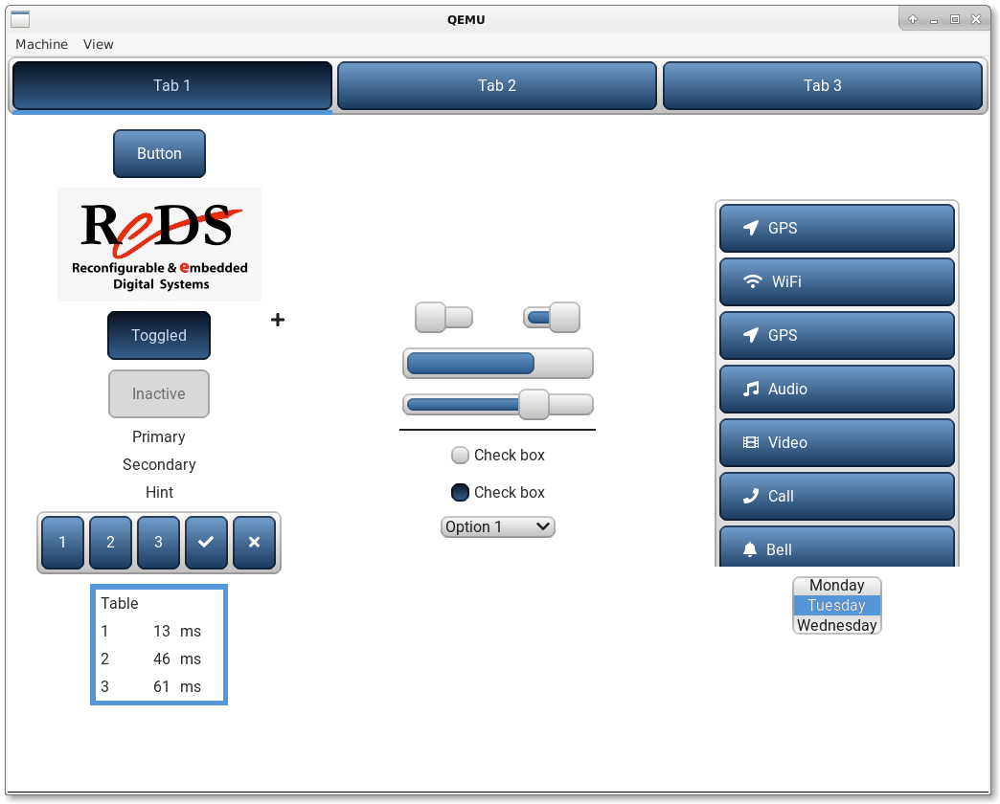
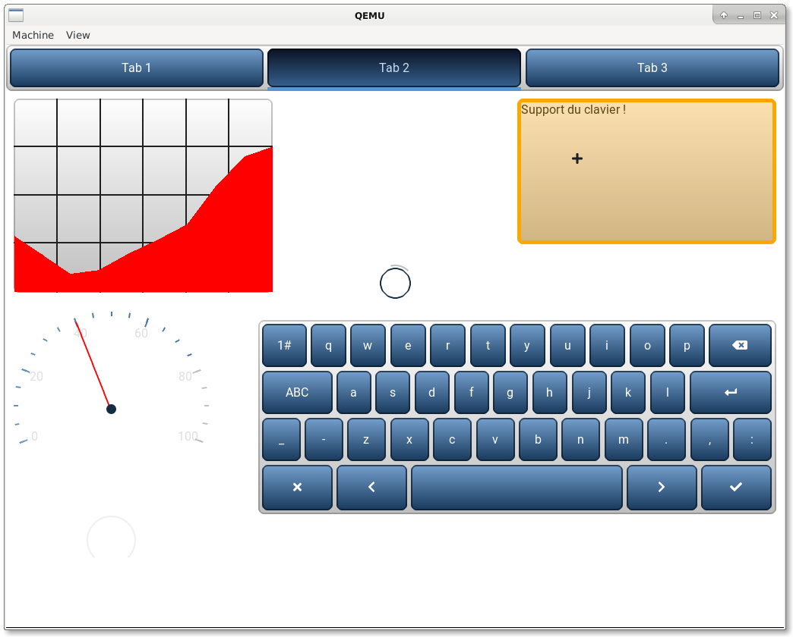

# Graphical User Interface {#sec-gui}

## Choosing LittlevGL {#sec-choosing-littlevgl}

The graphics library chosen for this work is LittlevGL, an open-source library written in C and released under the MIT license.[^lvgl] It was designed specifically for embedded systems, so it needs few resources. It can also copy the pixels of the GUI into a framebuffer: a region of RAM holding a binary representation of a set of pixels, to be shown on screen.

{#fig-lvgl-example fig-alt="A dark-themed LittlevGL interface with tabs, a calendar and a login form."}

At the start of the thesis, the goal was a Qt interface, with piloting a drone from a touchscreen as the guiding example. Qt, however, would have required adapting the system calls of SO3's C library, since SO3 applications are built with the standard `arm-linux-gnueabihf` toolchain. Prof. Rossier therefore suggested LittlevGL, at first only as a stepping stone towards a more complete library such as Qt or GTK. Given LittlevGL's many features, its thorough documentation and its active community, it was kept until the end of the thesis instead. In early April 2020, Qt was dropped from the plan, as was a task to secure the system with ARM TrustZone, in favor of bringing the work to SOO.

With the release of version 7 in May 2020, the project was renamed LVGL (*Light and Versatile Graphics Library*). This book keeps the name LittlevGL, because version 6.1.2 (February 2020) is the one integrated into SO3.

## Integration and configuration {#sec-lvgl-integration}

The library comes as a directory named `lvgl` holding its source code, along with several Makefile fragments listing the source files to compile. There is, however, no Makefile that actually builds the library.

A configuration file, `lv_conf.h`, is also provided and must sit next to the `lvgl` directory. It holds settings such as the maximum resolution the library must support, the number of bits per pixel and the log level.

The maximum resolution was set to 1920×1080, which is plenty for an embedded system. The effective resolution, limited by the screen in use, is passed to LittlevGL by the user application. Two other settings were changed. The number of bits per pixel was set to 32: one byte each for alpha (transparency), red, green and blue. Logging was turned on, at the *warning* level and printed with `printf`.

The library lives in the user space of SO3 rather than in the kernel, since user applications are the ones using it. It was placed in `so3/usr/lvgl`, giving the layout shown in @fig-usr-tree.

::: {#fig-usr-tree}

```{.default}
usr/
├── libc/
├── lvgl/
│   ├── lvgl/         LittlevGL sources
│   ├── lv_conf.h     LittlevGL configuration
│   └── Makefile      builds liblvgl.a
├── out/
├── resources/
├── src/
├── deploy.sh
├── Makefile
└── Makefile.common
```

Layout of `so3/usr/` with LittlevGL added.
:::

## Compilation {#sec-lvgl-compilation}

The `lvgl/Makefile` had to be written so that it produces a static library, which can then be linked into the executable of each application in `usr/src/`.

This Makefile is simple. Its `all` target compiles every C file listed by the `*.mk` fragments mentioned above, then bundles the resulting object files into the `liblvgl.a` archive with `ar`.

The `usr/` Makefile then had to link this library into each application. A new target that builds the library was added, and made a prerequisite of the target that produces each application's executable (an ELF file):

```makefile
out/%.elf: src/%.o $(LIBC_DIR)/$(NLIB) $(LVGL_DIR)/$(LVGL_LIB)
	$(LD) -o $@ libc/crt0.o libc/crt1.o $< \
	      -L$(LIBC_DIR) -lso3              \
	      -L$(LVGL_DIR) -llvgl $(LDFLAGS)

$(LVGL_DIR)/$(LVGL_LIB):
	make -C lvgl all
```

One pitfall: SO3's `.gitignore` excludes `*.mk` files, so LittlevGL's Makefile fragments had to be added to the repository explicitly, and they went missing twice along the way.

Any SO3 application can now use LittlevGL simply by including `lvgl/lvgl.h`. @fig-build gives an overview of the whole build.

{#fig-build fig-alt="Three rows of build steps. The application's demo.c is compiled by gcc into demo.o. The C library and LittlevGL sources are each compiled into object files and archived by ar into libso3.a and liblvgl.a. All three outputs feed the linker, ld, which produces demo.elf."}

## Using LittlevGL {#sec-lvgl-usage}

Every application that uses LittlevGL must call a few of its functions and initialize some of its structures. Knowing what these are makes it easier to understand the changes SO3 needs. The following excerpt shows a simplified LittlevGL application. A complete, working example was written in `usr/src/demo.c`.

```c
#include "lvgl/lvgl.h"

int main(int argc, char **argv)
{
    /* Internal LittlevGL initialization. */
    lv_init();

    /* User-defined initializations. */
    fs_init();
    fb_init();
    mouse_init();
    keyboard_init();

    create_ui();

    /* LittlevGL must know how time passes by. */
    pthread_t thread;
    pthread_create(&thread, NULL, tick_routine, NULL);

    /* Run LittlevGL-defined tasks. */
    while (1) {
        lv_task_handler();
        usleep(5000);
    }

    return 0;
}

void *tick_routine(void *args)
{
    /* Tell LittlevGL that 5ms passed. */
    while (1) {
        usleep(5000);
        lv_tick_inc(5);
    }
}
```

`lv_init` initializes several of LittlevGL's modules, so calling it is mandatory.[^quick-overview] The `*_init` functions that follow are written by the developer, and each one sets up some LittlevGL structures. They are covered in detail below.

Two other pieces are essential. The first is a thread that tells LittlevGL, at regular intervals, how much time has passed, by calling the library's `lv_tick_inc` function.[^tick] This is how the library knows when to run animations and tasks, such as reading the mouse coordinates. The second is a call to `lv_task_handler` every 5 milliseconds, the interval LittlevGL recommends. This function runs tasks defined either by the library, such as redrawing the parts of the interface that changed, or by the developer, though this application defines none.[^task-handler]

{#fig-lvgl-app fig-alt="The LittlevGL application in user space uses LittlevGL and the C library. Through the C library, it reaches the framebuffer driver and the input drivers in the kernel. The framebuffer driver drives the display, and the input drivers receive events from the keyboard and mouse."}

### Displaying the interface {#sec-lvgl-display}

#### The framebuffer {.unnumbered}

To display the GUI that LittlevGL generates, the user space of SO3 needs a way to access the framebuffer and write to it.

As defined in @sec-choosing-littlevgl, the framebuffer is a region of memory[^framebuffer] holding the pixels shown on screen. A dedicated device controller, a hardware circuit, manages it. The controller is configured to decide how pixels are laid out in memory: the number of bits per color, the order of the colors, and so on.

With 24 bits per pixel (*bpp*), for example, 8 bits each for red, green and blue, more than 16 million colors can be shown. Each pixel then takes four bytes. The first byte is either ignored or used for opacity, and the other three are read as RGB or BGR (red and blue swapped), depending on how the controller is configured.

Talking to this controller requires a driver, which lives in the kernel rather than in user space. A driver is written for one specific controller, and each embedded system has its own set of controllers, unless it reuses existing ones. From user space, then, it is the framebuffer driver that the application must talk to.

Linux and other Unix-like operating systems provide special files, also called device files,[^device-file] which exist on no file system such as FAT or NTFS but give access to a device. A framebuffer, for example, is represented by a file named `/dev/fbX`, where `X` is a number. The technique is attractive because it extends to other devices, including input devices like the keyboard and the mouse, with file names such as `/dev/keyboardX` or `/dev/mouseX`.

SO3 could already open regular files but did not support special files, so they were added, as described in @sec-special-files.

In Linux, once the framebuffer file is open and its file descriptor obtained with the `open` system call, writing to the file writes to the framebuffer. Calling `write` over and over, however, hurts the application's performance.

A faster technique is to make the framebuffer's memory directly accessible from user space. This is what the `mmap` system call does, and it only needs to be called once. It returns a pointer to the framebuffer's memory, through which the application can then write pixels. SO3 had no `mmap` system call either, so it had to be implemented too.

Concretely, here is the code needed to write a single pixel into the framebuffer. The same mechanism is what lets the interface drawn by LittlevGL be copied into the framebuffer.

```c
#include <fcntl.h>
#include <sys/mman.h>

/* Open the framebuffer. */
int fd = open("/dev/fb0", O_WRONLY);

/* Map its memory into user space. */
uint32_t *fbp = mmap(NULL, FB_SIZE, PROT_WRITE, MAP_SHARED, fd, 0);

/* Red pixel: red in bits 16-23. */
fbp[0] = 0x00ff0000;
```

This is the POSIX form. SO3's `mmap` ignores the protection and flag arguments, and the size `FB_SIZE` is obtained from the driver, as @sec-fb-properties explains.

#### LittlevGL's display driver {.unnumbered}

In LittlevGL's terminology, a *driver* is a C structure that enables a feature. Each driver has one or more *callback* functions attached, which the library calls when needed.

The display driver,[^display] for example, must be given a buffer that LittlevGL uses to draw the interface. It also needs a callback that copies this buffer into the framebuffer. If the buffer is smaller than the screen, the interface is drawn in several passes, so there is a trade-off between memory use and CPU use. The demo gives it 256 × 256 pixels, or 256 KB at 4 bytes per pixel, about a twelfth of a 1024×768 screen. Either way, LittlevGL only redraws the parts of the interface that changed.

LittlevGL can also be given a second buffer, so that drawing the interface and copying it to the framebuffer happen in parallel. This only pays off if the copy is done by hardware, such as a direct memory access (DMA) controller, while the CPU draws the next frame. SO3 has no driver for such hardware, so a single buffer was used.

The following code initializes the driver:

```c
/* Buffer initialization. */
static lv_color_t buf[LVGL_BUF_SIZE];
static lv_disp_buf_t disp_buf;
lv_disp_buf_init(&disp_buf, buf, NULL, LVGL_BUF_SIZE);

/* Driver initialization. */
static lv_disp_drv_t disp_drv;
lv_disp_drv_init(&disp_drv);
disp_drv.hor_res = scr_hres;
disp_drv.ver_res = scr_vres;
disp_drv.buffer = &disp_buf;
disp_drv.flush_cb = my_fb_cb;
lv_disp_drv_register(&disp_drv);
```

And this is its callback, which copies the area LittlevGL just drew into the framebuffer, through the pointer obtained earlier:

```c
void my_fb_cb(lv_disp_drv_t *disp,
              const lv_area_t *area,
              lv_color_t *pixel)
{
    lv_coord_t y, line_width = lv_area_get_width(area);
    uint32_t line_size = line_width * sizeof(lv_color_t);

    /* Copy line-by-line. */
    for (y = area->y1; y <= area->y2; y++) {
        memcpy(&fbp[y * scr_hres + area->x1], pixel, line_size);
        pixel += line_width;
    }

    lv_disp_flush_ready(disp);
}
```

### Handling input devices {#sec-lvgl-input}

The keyboard and the mouse can be reached the same way as the framebuffer. SO3 had no keyboard or mouse drivers, so these had to be written as well.

Once the application has a file descriptor, reading from it or writing to it makes little sense without a protocol for exchanging data, to fetch the mouse coordinates for instance. Unix-like systems provide the `ioctl` system call[^ioctl] for this: it runs operations defined by the driver.

SO3 already had `ioctl`, so only the operations themselves had to be implemented. The keyboard needs a single one, which returns the last key pressed. The mouse needs two: one returns the mouse coordinates, and the other tells the driver the screen resolution. The driver needs the resolution to clamp the coordinates, so that the pointer cannot leave the screen.

#### Mouse input driver {.unnumbered}

LittlevGL's input driver[^indev] for the mouse is initialized much like the display driver. Its callback runs the operation that returns the mouse coordinates and button state. The operation that sets the screen resolution runs once, right after the mouse's file descriptor is obtained.

```c
int mfd = open("/dev/mouse0", 0);

struct display_res res = { .h = scr_hres, .v = scr_vres };
ioctl(mfd, IOCTL_MOUSE_SET_RES, &res);

/* Driver initialization. */
lv_indev_drv_t mouse_drv;
lv_indev_drv_init(&mouse_drv);
mouse_drv.type = LV_INDEV_TYPE_POINTER;
mouse_drv.read_cb = my_mouse_cb;
lv_indev_drv_register(&mouse_drv);
```

The demo also gives the pointer a cursor image, the + visible in @fig-demo-1, with `lv_indev_set_cursor`.

```c
bool my_mouse_cb(lv_indev_drv_t *indev, lv_indev_data_t *data)
{
    static struct ps2_mouse mouse;
    ioctl(mfd, IOCTL_MOUSE_GET_STATE, &mouse);

    data->state = mouse.left ? LV_INDEV_STATE_PR : LV_INDEV_STATE_REL;
    data->point.x = mouse.x;
    data->point.y = mouse.y;

    return false;
}
```

#### Keyboard input driver {.unnumbered}

The keyboard is registered as a *keypad*. LittlevGL only sends key presses to the objects of a group attached to the keypad, so the demo creates a group and later adds its text area and on-screen keyboard to it:

```c
int kfd = open("/dev/keyboard0", 0);

lv_indev_drv_t keyboard_drv;
lv_indev_drv_init(&keyboard_drv);
keyboard_drv.type = LV_INDEV_TYPE_KEYPAD;
keyboard_drv.read_cb = my_keyboard_cb;
lv_indev_t *keyboard_dev = lv_indev_drv_register(&keyboard_drv);

lv_group_t *keyboard_group = lv_group_create();
lv_indev_set_group(keyboard_dev, keyboard_group);
```

Its callback fetches the last key pressed with an `ioctl` call:

```c
bool my_keyboard_cb(lv_indev_drv_t *indev, lv_indev_data_t *data)
{
    static struct ps2_key key;
    ioctl(kfd, IOCTL_KB_GET_KEY, &key);

    if (key.value != 0) {
        data->key = key.value;
        data->state = key.state & 1;
    }

    return false;
}
```

### Accessing the file system {#sec-lvgl-fs}

LittlevGL also provides a driver[^fs] for accessing the file systems of the OS, which lets the interface display images stored on disk, for example. One such driver is initialized for each file system LittlevGL needs to access. Much like on Windows, each driver instance is assigned a letter that identifies its files, as in `S:/reds.bin`, the image shown by the demo. Images are converted beforehand to LittlevGL's binary format with its online converter. SO3 has a single file system, so a single driver is enough.

As with the drivers above, the file system driver relies on callbacks. Here they bridge LittlevGL and the standard C file functions, such as `fopen`, `fread` and `fclose`. In SO3, these functions come from musl,[^musl] an implementation of the C standard library.

```c
lv_fs_drv_t drv;
lv_fs_drv_init(&drv);

drv.letter = 'S';
drv.file_size = sizeof(FILE *);
drv.rddir_size = sizeof(FILE *);
drv.ready_cb = fs_ready_cb;     /* Drive is ready to use.       */
drv.open_cb = fs_open_cb;       /* Callback to open a file.     */
drv.close_cb = fs_close_cb;     /* Callback to close a file.    */
drv.read_cb = fs_read_cb;       /* Callback to read a file.     */
drv.seek_cb = fs_seek_cb;       /* Callback to set file cursor. */
drv.tell_cb = fs_tell_cb;       /* Callback to get file cursor. */
lv_fs_drv_register(&drv);
```

```c
lv_fs_res_t fs_open_cb(struct _lv_fs_drv_t *drv,
                       void *file_p,
                       const char *path,
                       lv_fs_mode_t mode)
{
    FILE *fp = fopen(path, (mode & LV_FS_MODE_WR) ? "w" : "r");
    if (!fp) {
        return LV_FS_RES_UNKNOWN;
    }

    *((FILE **)file_p) = fp;
    return LV_FS_RES_OK;
}

lv_fs_res_t fs_read_cb(struct _lv_fs_drv_t *drv,
                       void *file_p,
                       void *buf,
                       uint32_t btr, /* bytes to read */
                       uint32_t *br) /* bytes read */
{
    *br = fread(buf, sizeof(uint8_t), btr, *(FILE **)file_p);
    return LV_FS_RES_OK;
}
```

The `seek` and `tell` callbacks matter in practice: LittlevGL reads an image again whenever part of it must be redrawn, for instance after the pointer passes over it. SO3 had no matching functions at first, so an image was drawn correctly once but not redrawn properly. Prof. Rossier then implemented `fseek` and `ftell` in SO3, and the callbacks were rewritten on top of `fopen`, `fread`, `fseek` and `ftell` instead of the lower-level `open` and `read`.

@fig-lvgl-drivers shows how the LittlevGL drivers described above interact with the SO3 kernel. The kernel side, with SO3's drivers and its virtual file system, is the subject of @sec-so3.

{#fig-lvgl-drivers fig-alt="Inside the LittlevGL application, the display driver, the mouse and keyboard input drivers and the file system driver each go through the C library, using open, mmap and ioctl, to reach their kernel counterpart: the framebuffer driver, the mouse driver, the keyboard driver and the virtual file system. The input and file system drivers feed the display driver."}

### Demo application {#sec-lvgl-demo}

The code excerpts above come from a demo application, written to showcase LittlevGL's features but above all to check that the changes made to SO3 work. It lives in `usr/src/demo.c`.

Its interface (@fig-demo-1 and @fig-demo-2) has three tabs and is based on LittlevGL's demo code from GitHub.[^lv-examples] The rest of the application was written specifically for SO3. A video of the demo running in QEMU is available online.[^demo-video]

{#fig-demo-1 fig-alt="The first tab of the demo application in a QEMU window, showing buttons, the REDS logo, switches, sliders, check boxes, a list and a table."}

{#fig-demo-2 fig-alt="The second tab of the demo application in a QEMU window, showing a line chart, a gauge, a text area and an on-screen keyboard."}

[^lvgl]: <https://lvgl.io>
[^quick-overview]: <https://docs.lvgl.io/6.1/get-started/quick-overview.html>
[^tick]: <https://docs.lvgl.io/6.1/porting/tick.html>
[^task-handler]: <https://docs.lvgl.io/6.1/porting/task-handler.html>
[^framebuffer]: <https://en.wikipedia.org/wiki/Framebuffer>
[^device-file]: <https://en.wikipedia.org/wiki/Device_file>
[^display]: <https://docs.lvgl.io/6.1/porting/display.html>
[^ioctl]: <https://en.wikipedia.org/wiki/Ioctl>
[^indev]: <https://docs.lvgl.io/6.1/porting/indev.html>
[^fs]: <https://docs.lvgl.io/6.1/overview/file-system.html>
[^musl]: <https://musl.libc.org>
[^lv-examples]: <https://github.com/lvgl/lv_examples/blob/release/v6/lv_tests/lv_test_theme/lv_test_theme_1.c>
[^demo-video]: <https://www.youtube.com/watch?v=skn_mp3ZBhI>
