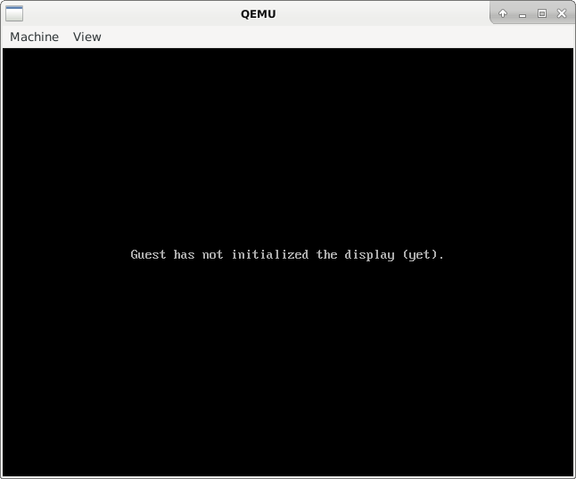
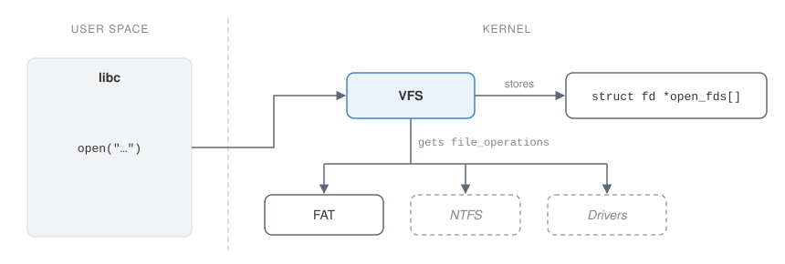
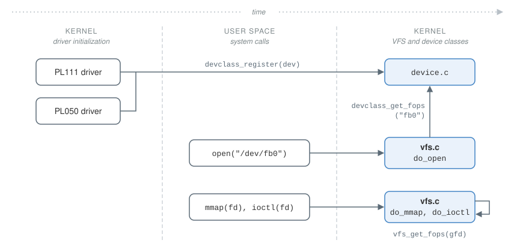
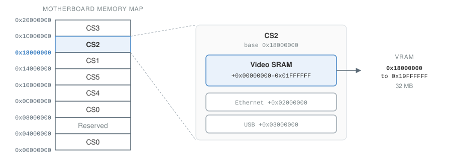
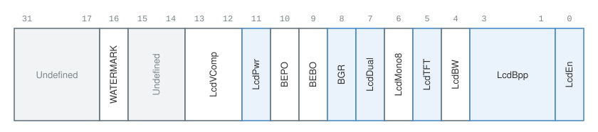
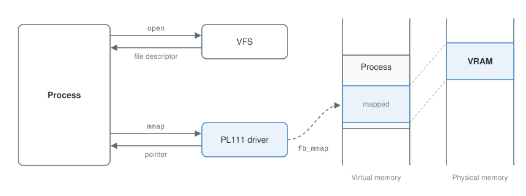

# SO3 {#sec-so3}

SO3 is an operating system written from scratch by REDS and dedicated to ARM processors. It is not based on the Linux kernel: it is lighter, and easier to study and modify for people new to operating system development.

The previous chapter described how LittlevGL works and introduced the changes SO3 needs for the library to run. This chapter goes through those changes in detail.

## Development environment {#sec-so3-environment}

### QEMU {#sec-qemu}

To speed up development, SO3 is not deployed to an embedded system such as the Raspberry Pi 4 after every change. Instead, it runs on a platform emulated by QEMU, which makes testing changes much faster.

REDS uses QEMU to emulate the ARM Versatile Express platform with a Cortex-A15 processor.[^qemu-vexpress] Once SO3 is running on it, the developer talks to it through a UART interface, which sends and receives characters between the development machine and SO3. Note that this requires neither a keyboard driver nor a framebuffer driver on the SO3 side, only a UART driver, which SO3 already has.

Since SO3 had no graphics support, QEMU was started with the `-nographic` option, which disables graphical output. This option must be removed so that QEMU can show the contents of the framebuffer. The `-display gtk` option can be used too, but `gtk` is already the default. For it to work, QEMU must have been built with `--enable-gtk`. Once QEMU starts, a new window shows the message *Guest has not initialized the display (yet)* (@fig-qemu-no-display).

{#fig-qemu-no-display fig-alt="An empty QEMU window with the message: Guest has not initialized the display (yet)." width="70%"}

### ARM Versatile Express {#sec-versatile-express}

The Versatile Express platform is made up of several device controllers, each with a specific role. To display the GUI, the PL111 controller (*PrimeCell Color LCD Controller*) manages the framebuffer. To talk to the mouse and keyboard, the PL050 controller (*PrimeCell PS2 Keyboard/Mouse Interface*) is used. A driver must be written for each of these controllers so that SO3 can use them.

## Special files {#sec-special-files}

As seen with LittlevGL, a user-space application can only talk to a controller's driver if the driver is represented by a special file. The file is special because it has no content and does not exist on the file system. It still counts as a file, though, because it is opened with the `open` system call, which returns a file descriptor.

The names of these files follow a convention close to that of Unix-like systems: `/dev/<device-class><device-id>`. `device-class` is the type of controller, such as `fb` for framebuffers or `mouse` for mice, and `device-id` numbers controllers of the same type. These values are defined in `so3/include/device/device.h`.

### The virtual file system {#sec-vfs}

The entry point from user space is the `open` system call, implemented by the `do_open` function in `so3/fs/vfs.c`. This file is SO3's virtual file system (VFS) layer, which handles files and directories independently of the underlying file system. SO3 currently uses FAT; if that changed, only the link between the VFS and the new file system would need adapting.

Before this work, `open` treated every file name it received as a file on the file system. It had to be changed so that names starting with `/dev/` are treated as special files.

When `do_open` opens a file, it creates a `fd` structure and associates it with a global file descriptor through the `open_fds` table. It also creates a local file descriptor, which refers to the global one but belongs to the calling process. The local descriptor is what user space gets back.

The `fd` structure matters because it holds a `file_operations` structure: the operations defined for that particular file. For files on the file system, the file system defines these operations. For special files, the operations are specific to each device, so the device's driver must define them.

Each of these operations corresponds to a system call. The `open` system call, for example, runs the file's `open` operation, and the same goes for `read`, `write`, `close`, `ioctl`, `mmap` and others.

@fig-vfs-open shows how the VFS is used when a file is opened. The VFS gets the file operations from one of several sources and stores them in the open file's `fd` structure, where they can be retrieved later.

{#fig-vfs-open fig-alt="A call to open in the C library reaches the VFS in the kernel. The VFS gets the file operations from a source, either the FAT file system or, as examples, NTFS or a driver, then stores them in the struct fd entry of the open_fds table."}

### Implementation {#sec-special-files-implementation}

From `do_open`, then, SO3 must be able to retrieve the file operations of the driver that matches the file name. For this, a new structure was created: `devclass`. Among other things, it holds the controller type (such as `fb`) and the file operations the driver defines. A list of `devclass` structures lives in `so3/device/device.c`.

A driver adds itself to this list by calling `devclass_register`. The VFS, in turn, calls `devclass_get_fops` to retrieve a driver's file operations. Both functions are defined in `device.c`.

The following code shows how a driver declares its operations. A driver does not have to do this: not every driver needs to be reachable from user space.

```c
struct file_operations driver_fops = {
    /* file operations to be defined */
};

struct devclass driver_cdev = {
    .class = DEV_CLASS_, /* device class, defined in device.h */
    .fops = &driver_fops,
};

int driver_init(dev_t *dev)
{
    devclass_register(dev, &driver_cdev);
    return 0;
}
```

The next excerpt is a simplified version of `do_open`, showing how the VFS retrieves the file operations the driver defined above:

```c
int do_open(const char *filename, int flags)
{
    int fd, gfd, type;
    struct file_operations *fops;

    /* Special file. */
    if (!strncmp(DEV_PREFIX, filename, DEV_PREFIX_LEN)) {
        /* Get fops defined by the driver. */
        fops = devclass_get_fops(filename + DEV_PREFIX_LEN, &type);
    }

    /* File on the filesystem. */
    else {
        /* Get fops of the FAT filesystem. */
        fops = registered_fs_ops[0];
    }

    /* Create struct fd entry in open_fds and stores fops. */
    fd = vfs_open(filename, fops, type);

    /* Global file descriptor, created in vfs_open. */
    gfd = current()->pcb->fd_array[fd];

    /* Call the open file operation, if defined. */
    if (fops->open) {
        fops->open(gfd, filename);
    }

    /* Return local file descriptor. */
    return fd;
}
```

With this in place, user space can get a file descriptor tied to a device. Through that descriptor it can then run other operations, such as `mmap` and `ioctl`, which the following sections rely on.

@fig-special-files gives an overview of special files in SO3, showing when a driver registers its file operations and when the VFS retrieves them.

{#fig-special-files fig-alt="Three columns. At boot, the PL111 and PL050 drivers in the kernel call devclass_register, which stores their operations in device.c. Later, user space calls open on /dev/fb0; do_open in vfs.c calls devclass_get_fops to get the operations from device.c. When user space then calls mmap or ioctl on the file descriptor, do_mmap and do_ioctl in vfs.c call vfs_get_fops to retrieve the operations stored when the file was opened."}

## Framebuffer driver {#sec-fb-driver}

Writing the framebuffer driver starts with identifying the matching controller on the platform. On the ARM Versatile Express platform, this is the PL111.[^pl111-trm]

A new `fb` directory was created in `so3/devices`, and the driver was written in `pl111.c`.

### The PL111 {#sec-pl111}

The PL111 has a number of registers that enable and configure it. @tbl-pl111-registers lists the ones used here, as described in ARM's *PL111 Technical Reference Manual*.

| Name       | Offset  | Type | Reset value  | Description                          |
|:-----------|:--------|:-----|:-------------|:-------------------------------------|
| LCDTiming0 | `0x000` | R/W  | `0x00000000` | Horizontal axis panel control        |
| LCDTiming1 | `0x004` | R/W  | `0x00000000` | Vertical axis panel control          |
| LCDTiming2 | `0x008` | R/W  | `0x00000000` | Clock and signal polarity control    |
| LCDTiming3 | `0x00C` | R/W  | `0x00000`    | Line end control                     |
| LCDUPBASE  | `0x010` | R/W  | `0x00000000` | Upper panel frame base address       |
| LCDLPBASE  | `0x014` | R/W  | `0x00000000` | Lower panel frame base address       |
| LCDControl | `0x018` | R/W  | `0x0000`     | LCD control                          |

: The PL111 registers used by the driver. {#tbl-pl111-registers tbl-colwidths="[17,11,8,18,46]"}

#### Enabling the controller {.unnumbered #sec-pl111-enable}

Section 1.1.8 of the manual describes how to power up the controller: two bits of the control register, LcdEn and LcdPwr, must be set to 1 (@fig-lcd-control). Setting them makes QEMU's *Guest has not initialized the display (yet)* message disappear.

#### Framebuffer location {.unnumbered}

Depending on its configuration, the PL111 can drive one or two panels (the LcdDual bit of LCDControl). Only one panel is needed here, so LcdDual is set to 0.

The PL111 lets the driver choose where the two framebuffers live in RAM. The address of the first panel goes in the LCDUPBASE register (*upper panel*), and that of the second in LCDLPBASE (*lower panel*).

These are fixed physical addresses, and they must be aligned on four bytes (their last two bits are 0). Since only one panel is used, LCDLPBASE is set to 0. The Versatile Express platform dedicates 32 MB of video memory (*video SRAM*, or VRAM) to this purpose, located at address `0x18000000`, and this is the address used for LCDUPBASE. @fig-vram-address shows where this address comes from, based on the *Motherboard Express µATX Technical Reference Manual*.[^motherboard-trm]

{#fig-vram-address fig-alt="The motherboard's memory map from 0x00000000 to 0x20000000 is divided into chip selects. CS2 starts at 0x18000000. The video SRAM occupies offsets 0x00000000 to 0x01FFFFFF of CS2, so its physical addresses run from 0x18000000 to 0x19FFFFFF."}

#### Setting the resolution {.unnumbered}

The resolution of an LCD screen is set by its *timing* parameters. There are four timing registers, numbered 0 to 3. The first two matter most, since they configure the screen resolution.

In the first, six bits encode the number of pixels per line (PPL), defined as $H / 16 - 1$, where $H$ is the desired horizontal resolution. In the second, ten bits encode the number of lines per panel (LPP), defined as the vertical resolution minus 1.

Both registers hold other values that must be filled in too. Example values for these fields can be found in various Device Tree Source (DTS) files of the Linux kernel.

The last two timing registers configure properties of the clock signals.

#### The control register {.unnumbered}

The control register is one of the most important, since it is the one that enables the controller, as explained in [Enabling the controller](#sec-pl111-enable). It also sets, among other things, the number of bits per pixel (bpp), the type of screen (TFT or STN), the number of panels (one or two), and whether red and blue are swapped (BGR or RGB).

{#fig-lcd-control fig-alt="A 32-bit register diagram. Bits 31 to 17 are undefined. Bit 16 is WATERMARK, bits 15 and 14 are undefined, bits 13 and 12 are LcdVComp, bit 11 is LcdPwr, bit 10 is BEPO, bit 9 is BEBO, bit 8 is BGR, bit 7 is LcdDual, bit 6 is LcdMono8, bit 5 is LcdTFT, bit 4 is LcdBW, bits 3 to 1 are LcdBpp and bit 0 is LcdEn. LcdPwr, BGR, LcdDual, LcdTFT, LcdBpp and LcdEn are highlighted."}

#### Writing the registers {.unnumbered}

The driver's initialization function, `pl111_init`, writes the values above into their registers with `iowrite32`. The function is registered with the kernel through the `REGISTER_DRIVER_POSTCORE` macro. SO3 distinguishes CORE and POSTCORE drivers so that the kernel can initialize the CORE drivers first.

### Mapping the memory {#sec-mmap}

Once the LittlevGL application has a file descriptor for the framebuffer, it calls `mmap` to map part of its memory onto the framebuffer. The location of that memory in the process is passed by the C library's `mmap`, and so is decided by user space.

The kernel side of `mmap` was added to the VFS, in the `do_mmap` function, and it is simple. First, it computes the number of pages to map by dividing the size of the region (a parameter) by the page size (a kernel constant). Then, from the local file descriptor it receives, it looks up the global descriptor, and from that the file operations the driver defined. `mmap` is one of these operations, and `do_mmap` calls it.

The core logic of the `mmap` system call is therefore defined by the driver, and can differ from one device to another. This split is very close to what Unix-like systems do.

The PL111 driver implements the `mmap` operation. The operation receives the virtual address in the process where the mapping should start, chosen by user space, and the number of pages to map. It maps the virtual address onto the physical address of the VRAM with the `create_mapping` function from `mmu.c`:

```c
void *fb_mmap(int fd, uint32_t virt_addr, uint32_t page_count)
{
    uint32_t i;

    for (i = 0; i < page_count; i++) {
        create_mapping(current()->pcb->pgtable,
                       virt_addr + i * PAGE_SIZE,
                       LCDUPBASE + i * PAGE_SIZE,
                       PAGE_SIZE, false);
    }

    return (void *) virt_addr;
}

struct file_operations pl111_fops = {
    .mmap = fb_mmap
};
```

{#fig-fb-mmap fig-alt="The process opens the framebuffer through the VFS and gets a file descriptor back. It then calls mmap, which reaches the PL111 driver; the driver's fb_mmap maps a region of the process's virtual memory onto the VRAM in physical memory, and the process gets a pointer to that region."}

### Framebuffer properties {#sec-fb-properties}

To call `mmap` correctly, user space must know the size of the framebuffer's memory. This size depends on the screen resolution and the number of bits per pixel, both set by the driver as seen above.

The user application also needs the screen resolution itself: to pass it to LittlevGL's display driver, and to the mouse driver so that the pointer stays within the screen.

These properties are retrieved with the `ioctl` system call. It already existed and needed no changes; only the operations themselves had to be implemented in the PL111 driver, just like `mmap`.

`ioctl` takes the identifier of the command to run, plus an integer used to pass extra parameters or to return a value, in which case it is used as a pointer. The identifier is defined by the driver, and must be a constant so that user space can know it too.

The following code shows the driver's `ioctl` implementation:

```c
int fb_ioctl(int fd, unsigned long cmd, unsigned long args)
{
    switch (cmd) {

        /* Horizontal resolution. */
        case IOCTL_HRES:
            *((uint32_t *) args) = HRES;
            return 0;

        /* Vertical resolution. */
        case IOCTL_VRES:
            *((uint32_t *) args) = VRES;
            return 0;

        /* Framebuffer size. */
        case IOCTL_SIZE:
            *((uint32_t *) args) = HRES * VRES * 4; /* assume 24bpp */
            return 0;

        /* Unknown command. */
        default:
            return -1;
    }
}
```

## Keyboard and mouse drivers {#sec-input-drivers}

Again, the first step is to identify the controller that talks to the keyboard and mouse. On the ARM Versatile Express platform, this is the PL050,[^pl050-trm] and there are two of them: the first, KMI0, talks to the keyboard, and the second, KMI1, to the mouse.

The driver and the input devices communicate using the PS/2 protocol.

A new `input` directory was created in `so3/devices`. A keyboard driver and a mouse driver were written, spread across several files:

- `pl050.c`: code shared by the mouse and the keyboard.
- `kmi0.c`: the keyboard driver.
- `kmi1.c`: the mouse driver.
- `ps2.c`: helpers for communicating with the mouse and the keyboard.

### The PL050 {#sec-pl050}

@tbl-pl050-registers lists the PL050's registers, as described in ARM's *PL050 Technical Reference Manual*.

| Offset | Name      | Type | Width | Reset value | Description                                     |
|:-------|:----------|:-----|:------|:------------|:------------------------------------------------|
| `0x00` | KMICR     | R/W  | 6     | `0x00`      | Control register                                |
| `0x04` | KMISTAT   | R    | 7     | `0x43`      | Status register                                 |
| `0x08` | KMIDATA   | R/W  | 8     | `0x00`      | Received data (read), data to transmit (write)  |
| `0x0C` | KMICLKDIV | R/W  | 4     | `0x00`      | Clock divisor register                          |
| `0x10` | KMIIR     | R    | 2     | `0x00`      | Interrupt status register                       |

: The PL050 registers, as offsets from the controller's base address. {#tbl-pl050-registers tbl-colwidths="[10,17,8,9,15,41]"}

#### Enabling the controller {.unnumbered}

The controller is initialized through two registers: KMICLKDIV (*clock divisor register*) and KMICR (*control register*).

According to ARM's documentation, the reference clock must produce an 8 MHz signal. KMICLKDIV holds the value used to divide the reference clock down to those 8 MHz. The value 2 was taken from the Linux driver.

The control register (KMICR) must then be set to enable the controller (bit KmiEn) and the interrupts raised when data is received from the device (bit KMIRXINTREn). The driver also sets KMITXINTREn, which enables interrupts raised when data can be sent to the device, although it never acts on them.

The interrupt service routine, which runs whenever the driver can read data sent by the device, must also be registered with SO3's interrupt controller. This is done with the `irq_bind` function, defined in `irq.c`.

All of this happens in the `pl050_init` function of `pl050.c`:

```c
int pl050_init(dev_t *dev, dev_t *dev_copy, struct devclass *cdev,
               irq_return_t (*isr)(int, void *))
{
    /* Set the clock divisor (arbitrary value). */
    iowrite8(dev->base + KMI_CLKDIV, 2);

    /* Enable transmitter and receiver interrupt. */
    iowrite8(dev->base+KMI_CR, KMICR_EN | KMICR_RXINTREN | KMICR_TXINTREN);

    /* Bind the ISR to the interrupt controller. */
    irq_bind(dev->irq, isr, NULL, NULL);

    /* Register the input device so it can be accessed from user space. */
    devclass_register(dev, cdev);

    return 0;
}
```

#### Sending data {.unnumbered}

To send data to the device, the driver writes it to the 8-bit KMIDATA register. Before that, it must check that the register is empty, by making sure the TXEMPTY bit of the KMISTAT (*status*) register is set. This is the job of the `pl050_write` function in `pl050.c`:

```c
void pl050_write(dev_t *dev, uint8_t data)
{
    /* Check if we can actually write in the transmit registry. */
    uint8_t status = ioread8(dev->base + KMI_STAT);

    if (0 == (status & KMISTAT_TXEMPTY)) {
        printk("%s: write timeout.\n", __func__);
        return;
    }

    iowrite8(dev->base + KMI_DATA, data);
}
```

#### Receiving data {.unnumbered}

When the device writes data to the KMIDATA register, an interrupt is raised and the driver's service routine runs. The routine reads KMIDATA as long as the KMIRXINTR bit of the KMIIR (*interrupt status*) register is set.

This gathers the bytes read into a PS/2 packet, which is decoded differently depending on whether it comes from the mouse or the keyboard. The keyboard's service routine is `pl050_int_keyboard` in `kmi0.c`, and the mouse's is `pl050_int_mouse` in `kmi1.c`:

```c
irq_return_t pl050_int_keyboard(int irq, void *dummy)
{
    /* Read the interrupt status register. */
    uint8_t status, packet[2], i, tmp;
    status = ioread8(pl050_keyboard.base + KMI_IR);

    /* As long as a receiver interrupt has been asserted */
    i = 0;
    while (status & KMIIR_RXINTR) {

        tmp = ioread8(pl050_keyboard.base + KMI_DATA);

        /* Remember only the first 2 bytes. */
        if (i < 2) {
            packet[i++] = tmp;
        }

        /* Update status. */
        status = ioread8(pl050_keyboard.base + KMI_IR);
    }

    get_kb_key(packet, i, &last_key); /* defined in ps2.c */
    return IRQ_COMPLETED;
}
```

#### Decoding the mouse packets {.unnumbered}

Whenever the mouse moves, it sends a series of packets containing, among other things, the change in position along each axis since the previous packet, and the state of the mouse buttons. From this, the driver computes and stores the absolute coordinates of the mouse and the state of its buttons, in a `ps2_mouse` structure. The function that fills it is `get_mouse_state` in `ps2.c`:

```c
void get_mouse_state(uint8_t *packet,
                     struct ps2_mouse *state,
                     uint16_t max_x,
                     uint16_t max_y)
{
    if (!state->left) {
        state->left = packet[PS2_STATE] & BL;
    }

    if (!state->right) {
        state->right = packet[PS2_STATE] & BR;
    }

    if (!state->middle) {
        state->middle = packet[PS2_STATE] & BM;
    }

    /* Retrieve dx and dy values to compute the mouse coordinates. */
    state->x += GET_DX(packet[PS2_STATE], packet[PS2_X]);
    state->y -= GET_DY(packet[PS2_STATE], packet[PS2_Y]);

    state->x = CLAMP(state->x, 0, max_x);
    state->y = CLAMP(state->y, 0, max_y);
}
```

#### Decoding the keyboard packets {.unnumbered}

Decoding keyboard packets is much more involved.[^ps2-keyboard] The driver has to account for:

- the different kinds of keys: some send a 2-byte packet, others a 3-byte packet;
- the state of the key: pressed or released;
- modifier keys, such as Shift, Ctrl and Alt, which change the behavior of other keys, can be combined, and are each sent in their own packet;
- the different behaviors of a key press: A should type "a", Shift + A should type "A", while Ctrl + A should be able to trigger an action defined by user space.

All of this without even considering the keyboard layout, which the user could choose and change. To keep the driver simple, only these essentials were implemented:

- lowercase letters;
- uppercase letters, with the Shift key;
- a few control keys, such as the arrows, Backspace, Delete and Tab.

The driver translates the *scan codes* (key identifiers) found in the packets into UTF-8 characters, and stores the last code it computed in a `ps2_key` structure. The packets are decoded by the `get_kb_key` function in `ps2.c`.

To translate scan codes into UTF-8 characters, `ps2.c` contains several lookup tables, indexed as `table[scan code] = UTF-8 character`. The drawback of this approach is that many table entries are unused, which wastes memory.

```c
void get_kb_key(uint8_t *packet, uint8_t len, struct ps2_key *key)
{
    uint8_t i = 0;

    /* If the first byte is KEY_EXT then we will use the extended scan codes array. */
    key->state &= ~KEY_ST_EXTENDED;
    if (packet[i] == KEY_EXT) {
        key->state |= KEY_ST_EXTENDED;
        i++;
    }

    /* Change the pressed/released state bit. */
    key->state |= KEY_ST_PRESSED;
    if (packet[i] == KEY_REL) {
        key->state &= ~KEY_ST_PRESSED;
        i++;
    }

    /* Change the shift modifier bit (left or right shift key). */
    if (packet[i] == KEY_LSH || packet[i] == KEY_RSH) {
        key->value = 0;
        key->state ^= KEY_ST_SHIFT;
    }
    else {
        /* Convert the scan code to the wanted value. */
        if (key->state & KEY_ST_SHIFT) {
            key->value = scs[packet[i]];
        }
        else if (key->state & KEY_ST_EXTENDED) {
            key->value = sce[packet[i]];
        }
        else {
            key->value = sc[packet[i]];
        }
    }
}
```

### Reading coordinates and keys {#sec-input-ioctl}

User space reads the mouse position and the keys pressed through the `ioctl` system call, which runs an operation defined by the driver. First, it gets a file descriptor for the driver, the same way as for the framebuffer.

The available `ioctl` operations are defined in `kmi0.c` and `kmi1.c`:

- `SET_SIZE` tells the driver the screen resolution, so that it can clamp the mouse coordinates and keep the pointer on screen. It takes a `display_res` structure.
- `GET_STATE` returns the current mouse coordinates and button state, as a `ps2_mouse` structure.
- `GET_KEY` returns the last key pressed on the keyboard, as a `ps2_key` structure.

[^qemu-vexpress]: <https://www.qemu.org/docs/master/system/arm/vexpress.html>
[^pl111-trm]: ARM PrimeCell Color LCD Controller (PL111) Technical Reference Manual, <https://developer.arm.com/documentation/ddi0293/c/>
[^motherboard-trm]: ARM Motherboard Express µATX Technical Reference Manual, <https://developer.arm.com/documentation/dui0447/latest/>
[^pl050-trm]: ARM PrimeCell PS2 Keyboard/Mouse Interface (PL050) Technical Reference Manual, <https://developer.arm.com/documentation/ddi0143/c/>
[^ps2-keyboard]: <https://wiki.osdev.org/PS/2_Keyboard>
