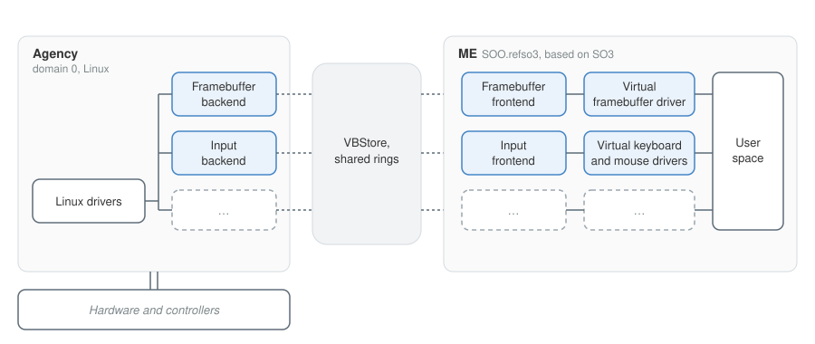
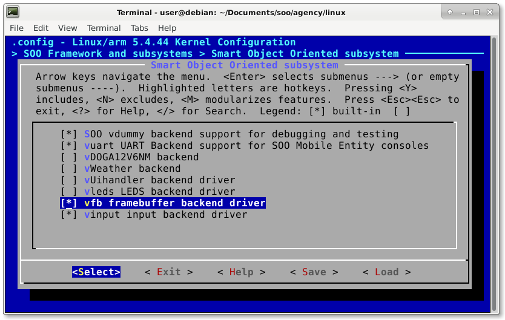
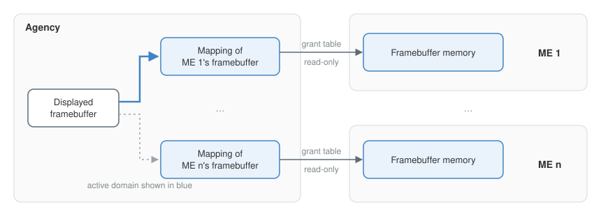
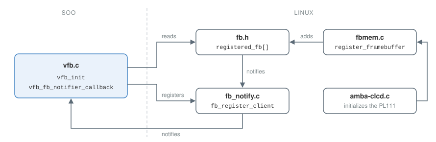
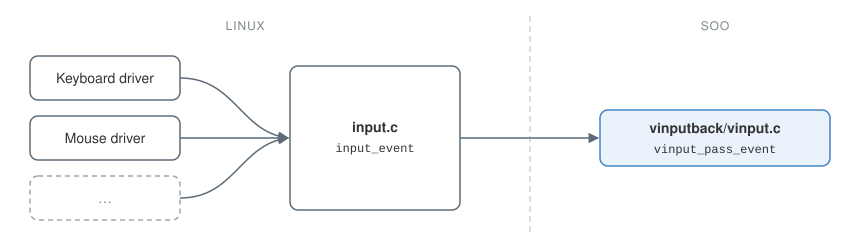
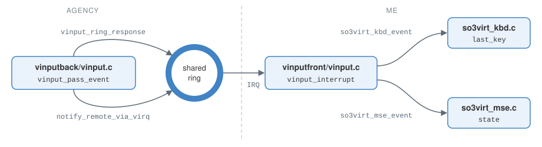

# SOO {#sec-soo}

## Overview {#sec-soo-overview}

The first part of this thesis added graphics support to SO3 running standalone: not virtualized, and with direct access to the hardware of the platform it runs on.

This second part brings those changes to an ME virtualized by SOO. The work is done on the ME called SOO.refso3, which, as its name suggests, is based on SO3.

To understand the changes needed, it helps to know the main components of SOO and how they interact. The AVZ hypervisor (*Agency Virtualizer*), developed by REDS, starts first. It is a type 1 hypervisor: it runs directly on the hardware rather than inside a host OS, and starts the operating systems it virtualizes. The first OS it virtualizes is the agency: a Linux kernel with several REDS additions that, among other things, let it communicate with the virtualized MEs.

The agency and the MEs are all *domains*. The agency is domain 0, and it is the only domain with access to the platform's hardware. Inside an ME, then, there is no hardware at all. To avoid changing the ME's user space, virtual drivers must be written that mimic the behavior of device drivers such as those of the PL111 and the PL050.

### Communication between the agency and MEs {#sec-agency-me}

These virtual drivers still need to reach the hardware, whether to write to the framebuffer or to receive input events. For this, each device needs a *backend* driver in the agency and a *frontend* driver in the ME. The backend has access to the hardware, since it lives in the agency. In general, it does not talk to the hardware directly, but relies on existing Linux drivers. The frontend, in the ME, talks to the virtual driver to make the device appear to exist.

The backend and the frontend, of course, need to talk to each other. REDS implemented several mechanisms for this. VBStore, for example, lets the agency or an ME write and read a value at a given path. There is also the *shared ring*, which carries requests (initiated by the frontend) and responses (initiated by the backend).

{#fig-soo-architecture fig-alt="The agency, on top of the hardware, holds the Linux drivers, which feed a framebuffer backend and an input backend. Through VBStore and shared rings, each backend talks to its frontend in the ME: the framebuffer frontend serves the virtual framebuffer driver, and the input frontend serves the virtual keyboard and mouse drivers, which the ME's user space uses."}

## Handling multiple MEs {#sec-multiple-mes}

Several MEs can be virtualized at the same time, so there can be several frontends for the same device. There is always a single backend per device, however: with several MEs running, one backend talks to several frontends.

The system must therefore know which ME's framebuffer to show on screen at any given time, and which ME should receive the data from the input devices. Once the agency has booted and its Linux shell is available, pressing Ctrl + A twice switches between domains, as shown below.

```{.default}
agency ~ # uname -a
Linux agency 5.4.44 #35 SMP Thu Jul 30 11:56:39 CEST 2020 armv7l GNU/Linux
agency ~ # *** Serial input -> ME-1(2) (type 'CTRL-a' twice to switch input to Agency domain).

so3% ls
cat.elf
demo.elf
dev/
echo.elf
fillfb.elf
ls.elf
more.elf
sh.elf
reds.bin
so3% *** Serial input -> Agency domain (type 'CTRL-a' twice to switch input to ME-1(2)).

agency ~ #
```

Domains are numbered: 0 is the agency, 1 is reserved for the agency's real-time domain, 2 to 6 are MEs, and 7 stands for the AVZ hypervisor. In the listing, ME-1(2) is the first ME, domain 2.

This mechanism was reused to track which domain is active and when the active domain changes. It decides which domain's framebuffer is shown on screen and which domain receives input events.

The changes were made in `linux/soo/kernel/console/console.c`. Originally, it was only possible to switch between the agency and the first ME. A more generic function, `get_next`, was written to return the identifier of the next domain. It uses `get_ME_desc` to detect whether an ME is running.

Then, in the `avz_switch_console` function, the identifier of the active domain is passed to the framebuffer backend and to the input backend, both described below, so that they know which domain is active and can act accordingly.

## Framebuffers {#sec-vfb}

### Creating the backend and frontend {#sec-vfb-creation}

The backend lives in `linux/soo/drivers/vfbback/vfb.c`, and the frontend in `SOO.refso3/so3/soo/drivers/vfbfront/vfb.c`. The name vfb stands for *virtual framebuffer*, following the convention of the other backends and frontends, such as vuart and vdummy.

The agency already contained an older vfb backend, and an older vinput backend, from earlier SOO work, which exchanged the framebuffer's properties in a different way. They were replaced by new backends built on vdummy, as described below, while the frontends and the ME's virtual drivers are new.

To build them, each of the `vfbback` and `vfbfront` directories has a Makefile naming the object file to produce. Since the source file is `vfb.c`, the object file is, by convention, `vfb.o`:

```makefile
# vfbback/Makefile
obj-$(CONFIG_VFB_BACKEND) := vfb.o

# vfbfront/Makefile
obj-$(CONFIG_VFB_FRONTEND) := vfb.o
```

The `CONFIG_VFB_*` variables belong to Kconfig, the configuration system of the Linux kernel, which SO3 also uses. Kconfig turns kernel components, such as drivers, on or off. A component that is turned off is not compiled, which gives a smaller binary.

This makes the vfb optional, so that MEs without a GUI can still be used. Both variables are declared: the backend's in `soo/drivers/Kconfig`, and the frontend's in `so3/soo/drivers/Kconfig`. The backend's declaration already existed; it was turned into a boolean option, off by default:

```{.default}
config VFB_BACKEND
    bool "vfb framebuffer backend driver"
    default N
    help
      This driver enabled to deal with a virtualized interface for a framebuffer in the Mobile Entity.
```

The kernel, Linux or SO3, is configured with `make menuconfig`, run in the directory holding the main Makefile. It opens an interface for turning kernel components on or off (@fig-kconfig).

{#fig-kconfig fig-alt="The menuconfig interface of the Linux 5.4.44 kernel, in the Smart Object Oriented subsystem menu, with the vfb framebuffer backend driver selected and enabled."}

Since the kernel treats the backend and frontend as drivers, the DTS files describing the platform's hardware must reference them. The following excerpt shows the nodes to add: the backend in `vexpress-tz.dts` (Linux, and likewise in `vexpress-notz.dts` and the Pi 4's `bcm2711-rpi-4-b.dts`), and the frontend in `so3virt.dts` (SO3).

```{.default}
agency {
    backends {
        vfb {
            compatible = "vfb,backend";
            status = "ok";
        };
    };
};

ME {
    frontends {
        vfb {
            compatible = "vfb,frontend";
            status = "ok";
        };
    };
};
```

The backend and frontend are now compiled, and are initialized when the agency and the ME boot. The backend is always initialized before the frontend, since it is one of the agency's drivers, and the ME only starts once the agency is up. The vfb backend and frontend were not written from scratch: they are based on vdummy, which provides a working skeleton for new backends and frontends. Once `vdummy.c` is copied, every occurrence of *vdummy* is replaced by *vfb*, without forgetting the headers (`vdummy.h`).

### Where the framebuffer lives {#sec-vfb-location}

As mentioned above, there is no hardware in an ME. Even though the ARM Versatile Express platform is still used, the ME has no access to the PL111 controller, nor to the platform's VRAM.

So where in memory should an ME put its framebuffer? An existing SOO mechanism, the *grant tables*, could give an ME access to the VRAM, so that it writes the GUI drawn by the LittlevGL application there.

This approach has two problems, though. First, it would need a mechanism that lets only the active ME write to the framebuffer; otherwise, every ME would keep overwriting what the others wrote.

Second, it would prevent the agency from accessing every ME's framebuffer regardless of the active domain. Tommy Girardi's Bachelor thesis,[^girardi] carried out alongside this one, needs exactly that: simultaneous access to the framebuffers of all virtualized MEs, to show each of them on one screen split into several parts. The approach above was therefore ruled out.

{#fig-multi-fb fig-alt="Each ME holds its own framebuffer memory and shares it through a grant table entry. The agency maps those entries, and points its framebuffer at the memory of the active ME."}

The chosen solution is to allocate memory for each ME's framebuffer. The allocation could happen either in the agency or in the ME. Both are technically possible, but it was decided to allocate in the ME.

Memory allocated in the agency, by the Linux kernel, is harder to protect, in particular against unwanted writes. When the memory is allocated in the ME, the access granted to the agency can be made read-only.

### Framebuffer size {#sec-vfb-size}

The size of the framebuffer depends on the screen resolution and the number of bits per pixel. Only the agency knows these, since it is the one with access to the hardware. They must therefore be passed to the ME, which needs them to allocate the framebuffer's memory.

#### Getting the framebuffer properties {.unnumbered}

The Linux kernel has a large number of drivers for different kinds of framebuffers (`drivers/video/fbdev`). When Linux detects a framebuffer controller, it initializes it and then registers a reference to the framebuffer in the `registered_fb` array of `fb.h`. The array holds pointers to `fb_info` structures, a complex structure Linux uses to describe and manipulate a framebuffer. Among other things, it holds a `fb_var_screeninfo` structure with the framebuffer's horizontal and vertical resolution and its number of bits per pixel.

{#fig-vfb-init fig-alt="In Linux, amba-clcd.c initializes the PL111 and calls register_framebuffer in fbmem.c, which adds the framebuffer to the registered_fb array in fb.h and notifies fb_notify.c. In SOO, vfb_init in vfb.c reads registered_fb directly, or registers a client with fb_register_client, so that its callback is notified once a framebuffer is registered."}

On the Versatile Express platform, Linux uses the `amba-clcd.c` driver to initialize the PL111. The driver does not know which values to use for the framebuffer, though: they come from the platform's DTS. The following excerpt, from `vexpress-v2m-rs1.dtsi`, is the node describing the PL111:

```{.default}
clcd@1f0000 {
    compatible = "arm,pl111", "arm,primecell";
    memory-region = <&vram>;

    panel {
        panel-timing {
            clock-frequency = <65000000>;
            hactive = <1024>;
            vactive = <768>;
            hsync-len = <136>;
            hfront-porch = <20>;
            hback-porch = <160>;
            vfront-porch = <3>;
            vback-porch = <29>;
            vsync-len = <6>;
        };
    };
};
```

It gives the desired resolution, 1024×768, and a reference to the VRAM, described in `vexpress-tz.dts`. The driver computes the number of bits per pixel from the `max-memory-bandwidth` property, which is not set here, so it picks 32 bits per pixel, which suits this work.

Next, the right framebuffer must be picked from `registered_fb`. For now, only one screen is expected to be attached to the embedded system, so picking the first framebuffer of the array is enough. This happens when the backend is initialized, in `vfb_init`: the first non-null `fb_info` of `registered_fb` decides which framebuffer is used, and is stored in a backend variable named `vfb_info`. A minimum resolution, set to 640×480, excludes framebuffers that are too small, such as the one an 8×8 LED matrix registers on the Pi 4.

Since the backend is a Linux driver just like the framebuffer drivers, there is no guarantee that the framebuffer driver is initialized before the backend, that is, that `registered_fb` is filled before the backend reads it. Linux, however, provides notifications for framebuffer events. The backend calls `fb_register_client`, defined in `fb_notify.c`, with a `notifier_block` structure holding a callback, which is then called for every framebuffer event.

Linux defines several such events, but the ones needed here were only available for the AM200 EPD platform. `fb.h` therefore had to be changed so that `FB_EVENT_FB_REGISTERED` and `FB_EVENT_FB_UNREGISTERED` are available on all platforms. The `do_register_framebuffer` and `do_unregister_framebuffer` functions in `fbmem.c` also had to be changed so that the events are actually sent. Both changes simply remove the `#ifdef`s Linux uses to restrict this code to the AM200 EPD platform.

If a framebuffer is already registered when the backend initializes, there is no need to listen for these events:

```c
int vfb_init(void)
{
    /* We check if there's already a registered framebuffer device. */
    int i = 0;
    while (i < FB_MAX && vfb_set_agencyfb(registered_fb[i]))
        i++;

    /* Otherwise, we register a client that will be notified when a
     * framebuffer is registered. */
    if (i == FB_MAX)
        fb_register_client(&vfb_fb_notif);

    return 0;
}
```

#### Passing the properties to the ME {.unnumbered}

The framebuffer resolution is passed to the MEs through VBStore: a path is created, holding one property for the horizontal resolution and one for the vertical resolution. VBStore suits this well, since the resolution is just two values, sent only when the ME starts. There is no need for a shared ring, a more complex mechanism, just to pass the framebuffer's properties.

Each backend has its own VBStore space, which must be initialized in the `vbstorage_agency_init` function of `vbstorage.c`:

```c
np = of_find_compatible_node(NULL, NULL, "vfb,backend");
if (of_device_is_available(np)) {
    vbs_store_mkdir("/backend/vfb");
}
```

This looks for a DTS node with the value `vfb,backend` and, if it finds one, creates the `/backend/vfb` path. A path is created the same way for each ME and each frontend, in `vbstore_me.c`. An entry must be added for the vfb, as shown in this excerpt of `vbstore_devices_populate`:

```c
fdt_node = fdt_find_compatible_node("vfb,frontend");
if (fdt_device_is_available(fdt_node)) {
    DBG("%s: init vfb...\n", __func__);
    vbstore_dev_init(ME_domID(), "vfb", false, "vfb,frontend");
}
```

This creates a path of the form `/devices/<domain-id>/vfb/0`. Since every ME shares the same framebuffer resolution, it could be written to the backend's VBStore space instead. It was written to each ME's space, though, to ease a possible future change where each ME would have its own resolution.

The backend creates the `device/<domain-id>/vfb/0/resolution` path with `vbus_mkdir`, defined in `vbus_vbstore.c`, then creates the `hor` and `ver` properties with `vbus_printf`:

```c
struct vbus_transaction vbt;
char dir[40];

vbus_transaction_start(&vbt);

sprintf(dir, "device/%01d/vfb/0", vdev->otherend_id);
vbus_mkdir(vbt, dir, "resolution");

sprintf(dir, "device/%01d/vfb/0/resolution", vdev->otherend_id);
vbus_printf(vbt, dir, "hor", "%u", FB_HRES);
vbus_printf(vbt, dir, "ver", "%u", FB_VRES);

vbus_transaction_end(vbt);
```

In the frontend's `vfb_probe` function, the resolution is read back with `vbus_scanf`, also defined in `vbus_vbstore.c`:

```c
struct vbus_transaction vbt;
uint32_t hres, vres;
char dir[40];

vbus_transaction_start(&vbt);
sprintf(dir, "device/%01d/vfb/0/resolution", ME_domID());
vbus_scanf(vbt, dir, "hor", "%u", &hres);
vbus_scanf(vbt, dir, "ver", "%u", &vres);
vbus_transaction_end(vbt);
```

### Allocating the memory {#sec-vfb-allocation}

Now that the frontend knows the resolution, it can allocate the framebuffer's memory, whose size is the horizontal resolution times the vertical resolution times the number of bytes per pixel.

The number of bits per pixel does not always map exactly to a number of bytes per pixel. The PL111, for example, has a 24 bpp mode, yet each pixel is still stored on 4 bytes, one of which is ignored. Linux and LittlevGL call this 32 bpp (also 4 bytes). The number of colors is the same, about 16 million, but in software the extra byte can be used for transparency.

The number of bytes per pixel is currently fixed to four in the backend. If that ever changed, the value would have to be passed to the frontend through VBStore, like the resolution.

Once the size is known, the frontend allocates the framebuffer's memory with `get_contig_free_pages`, which reserves a number of contiguous physical pages. These pages belong to no process and are never freed, which is very close to how the VRAM behaves.

```c
uint32_t fb_base, hres, vres, page_count;
char dir[40];

page_count = hres * vres * 4 / PAGE_SIZE;
fb_base = get_contig_free_pages(page_count);
BUG_ON(!fb_base);
so3virt_fb_set_info(fb_base, hres, vres);
```

#### The virtual driver {.unnumbered}

In SOO.refso3, the virtual driver replaces the PL111 driver described in @sec-fb-driver. It was written in `so3virt_fb.c`. As for the other drivers, a node was added to the `so3virt.dts` DTS:

```{.default}
so3virt-fb {
    compatible = "fb,so3virt";
    status = "ok";
};
```

It defines the same two file operations, `mmap` and `ioctl`, and its initialization function registers a `devclass` structure so that the `/dev/fb0` special file is available in the ME's user space.

The differences are in the initialization function: there is no device to initialize, so no registers to write. In `fb_mmap`, the physical address of the VRAM is replaced by the address the frontend reserved. The frontend passes that address with `so3virt_fb_set_info`, which also tells the virtual driver the screen resolution, needed by the `ioctl` operations.

### Mapping the framebuffer in the agency {#sec-vfb-mapping}

For the backend to access the memory reserved above, the frontend must grant access to every page of it. It does so right after reserving the memory, with `gnttab_grant_foreign_access`, which takes the agency's domain identifier and the page to grant.

This function, defined in `gnttab.c`, is part of the existing grant table mechanism, which lets domains share pages. It returns a reference to the new entry in the grant table. The backend needs this reference to access the ME's framebuffer. Being an integer, it can be written to the `device/<domain-id>/vfb/0/domfb-ref` path of VBStore:

```c
for (i = 0; i < page_count; i++) {
    res = gnttab_grant_foreign_access(vdev->otherend_id,
                                      phys_to_pfn(fb_base + i * PAGE_SIZE),
                                      1);
    BUG_ON(res < 0);

    if (i == 0) /* The back-end only needs the first grantref. */
        fb_ref = res;
}

sprintf(dir, "device/%01d/vfb/0/domfb-ref", ME_domID());
vbus_printf(vbt, dir, "value", "%u", fb_ref);
```

The backend creates this path beforehand, in its `vfb_probe` function. It also watches the path, so that it is notified whenever a property changes; when one does, `callback_me_domfb` is called:

```c
watches[vdev->otherend_id] = kzalloc(sizeof(struct vbus_watch), GFP_ATOMIC);
vbus_watch_pathfmt(vdev,
                   watches[vdev->otherend_id],
                   callback_me_domfb,
                   "device/%01d/vfb/0/domfb-ref/value",
                   vdev->otherend_id);
```

This callback allocates memory in the agency and maps it onto the memory reserved by the frontend, shared through the grant table:

```c
grant_ref_t fb_ref;
struct gnttab_map_grant_ref op;
struct vm_struct *area;
domid_t domid; /* ME domain id */

area = alloc_vm_area(FB_SIZE, NULL);

gnttab_set_map_op(&op,
                  (phys_addr_t) area->addr,
                  GNTMAP_host_map | GNTMAP_readonly,
                  fb_ref, domid, 0, FB_SIZE);

gnttab_map(&op);
```

SOO's `gnttab_map` maps a whole range, as large as requested, starting at the page of the given grant reference. The backend can therefore map the whole framebuffer from the first reference alone, which only works because `get_contig_free_pages` returns physically contiguous pages.

### Displaying the framebuffers {#sec-vfb-display}

As explained in @sec-multiple-mes, pressing Ctrl + A twice changes the active domain. With the changes made to `console.c`, this key sequence calls the backend's `vfb_set_active_domfb` function.

This function changes the PL111's registers, in particular LCDUPBASE, so that it holds the physical address of the framebuffer to display. It does so by changing some values of the framebuffer's `fb_info` structure, then calling the `fb_set_par` operation, which writes the structure's new values into the controller's registers. Calling this operation, defined in `fb_info`, runs `clcdfb_set_par` and then `clcdfb_set_start`, which changes the registers.

The `fb_info` value to change is the physical address of the framebuffer, `fb_info->fix.smem_start`. For consistency, the virtual address, `fb_info->screen_base`, is changed too.

To keep track of the physical and virtual addresses of the different framebuffers, a `vfb_domfb` structure was created. It represents a *domain framebuffer*, since it is used not only for the MEs but also for the agency. It holds:

- `domid_t id`: the identifier of the domain the framebuffer belongs to;
- `uint64_t paddr`: the physical address passed by the frontend;
- `char *vaddr`: the virtual address of the framebuffer;
- `struct vm_struct *area`: a pointer to the memory allocated by the backend;
- `grant_handle_t gnt_handle`: the identifier of the mapping created by the backend.

The last two values are needed when an ME shuts down, to unmap and free the allocated memory. The backend's `vfb_close` function releases these resources.

There is one `vfb_domfb` structure for each domain that displays a framebuffer. They are created in the `callback_me_domfb` function seen above (except for the agency's) and stored in the `registered_domfb` array, indexed by domain identifier. The array's size is therefore the maximum number of domains that can be virtualized. This number is taken from `console.c` and set to 8, one slot per domain number listed in @sec-multiple-mes, even though slots 1 and 7 never hold a framebuffer.

```c
struct gnttab_map_grant_ref op;
struct vm_struct *area;
struct vfb_domfb *fb;
domid_t domid;

fb = kzalloc(sizeof(struct vfb_domfb), GFP_ATOMIC);
fb->id = domid;
fb->paddr = op.dev_bus_addr << 12;
fb->vaddr = area->addr;
fb->area = area;
fb->gnt_handle = op.handle;
vfb_set_domfb(fb); /* added to registered_domfb */
```

The agency has its own `vfb_domfb` structure too, since it is useful to be able to switch back to the agency's framebuffer, which another application may have changed. The structure is created in `vfb_set_agencyfb`, called once the `fb_info` structure is found: either when the backend initializes, or when Linux registers a framebuffer and notifies the backend.

```c
static int vfb_set_agencyfb(struct fb_info *info)
{
    struct vfb_domfb *fb;

    if (vfb_info
        || !info
        || info->var.xres < MIN_FB_HRES
        || info->var.yres < MIN_FB_VRES) {
        return -1;
    }

    vfb_info = info;

    fb = kzalloc(sizeof(struct vfb_domfb), GFP_ATOMIC);
    fb->id = 0;
    fb->paddr = info->fix.smem_start;
    fb->vaddr = info->screen_base;

    vfb_set_domfb(fb);
    vfb_set_active_domfb(fb->id);

    return 0;
}
```

The call to `vfb_set_active_domfb` is needed because, even though Linux detects the PL111 and initializes its `fb_info` structure, it does not write the controller's registers. The call makes sure `clcdfb_set_par` runs.

Turning on Linux's *Framebuffer Console* driver would enable the controller, and make this call unnecessary. That driver causes a problem, though: it creates a thread to blink the console cursor, and when the `fb_info` structure changes (when the active domain changes), the thread can no longer write to its memory and crashes the Linux kernel. Since the driver is not needed, it is assumed to always be off.

### External notifications {#sec-vfb-notifications}

Part of Tommy Girardi's thesis needs to know when an ME's framebuffer is created, and when it is destroyed because the ME shut down. Since it needs the framebuffer's virtual address, a simple callback mechanism was implemented.

`vfb_set_callback_new_domfb` sets the function to call when a new entry is added to `registered_domfb`. The function must have the signature `void (*cb)(struct vfb_domfb *, struct fb_info *)`, and is called at the end of `callback_me_domfb`.

`vfb_set_callback_rm_domfb` sets the function to call when an ME shuts down. Its signature is `void (*cb)(domid_t id)`, and it is called in the backend's `vfb_close` function.

### Shutting down an ME {#sec-vfb-shutdown}

When an ME shuts down, several resources must be released:

- the `vbus_watch` structure used to be notified of changes to the path holding the grant reference must be unregistered, then freed;
- the memory allocated by the backend (the `vm_struct` structure) must be unmapped, then freed;
- the `vfb_domfb` entry must be removed from the array and freed.

```c
void vfb_close(struct vbus_device *vdev)
{
    struct gnttab_unmap_grant_ref op;

    /* Unregister and free the watch. */
    unregister_vbus_watch(watches[vdev->otherend_id]);
    kfree(watches[vdev->otherend_id]);
    watches[vdev->otherend_id] = NULL;

    /* Unmap the grantref. */
    gnttab_set_unmap_op(
        &op,
        (phys_addr_t) registered_domfb[vdev->otherend_id]->vaddr,
        GNTMAP_host_map | GNTMAP_readonly,
        registered_domfb[vdev->otherend_id]->gnt_handle);
    gnttab_unmap(&op);

    /* Free framebuffer area. */
    free_vm_area(registered_domfb[vdev->otherend_id]->area);

    /* Free vfb_domfb. */
    kfree(registered_domfb[vdev->otherend_id]);
    registered_domfb[vdev->otherend_id] = NULL;

    if (callback_rm_domfb) {
        callback_rm_domfb(vdev->otherend_id);
    }
}
```

## Input devices {#sec-vinput}

### Input events {#sec-input-events}

The *input* module of the Linux kernel is the one every input event goes through, whether it comes from a mouse, a keyboard, a touchscreen or any other input device. This module made writing the input backend and frontend, called vinput, much simpler.

Since Linux already has drivers for many input devices, there is no need to deal with the quirks of each one, as was done for the PL050. Moreover, for every event it receives, a device driver calls the `input_event` function of the Linux input module (`input.c`). Such an event[^event-codes] is made of three values, declared in `include/uapi/linux/input-event-codes.h`:

- `unsigned int type`: the type of event. There are about a dozen, but the ones of interest here are `EV_KEY` (keyboard keys and mouse buttons), `EV_REL` (mouse movement) and `EV_ABS` (touchscreen movement).
- `unsigned int code`: a code that identifies the event more precisely. For example, code 42 of type `EV_KEY` is the Left Shift key, and code 0 of type `EV_REL` is a mouse movement along the x axis.
- `int value`: the value of the event. For a key, whether it was pressed or released; for a mouse movement, the distance moved.

To get these events into the vinput backend, it is enough to change `input_event` so that it calls the backend's `vinput_pass_event` function, which forwards the event to the frontend.

{#fig-vinput-events fig-alt="The keyboard driver, the mouse driver and other Linux input drivers call input_event in input.c, which calls vinput_pass_event in the vinput backend, vinputback/vinput.c."}

### Creating the backend and frontend {#sec-vinput-creation}

The backend and frontend are created much like those of the framebuffer. They are based on vdummy and live in `vinput` directories; as with vfb, the new backend replaces an older one. A new node is added to both the Linux DTS and the ME's DTS, and the matching Kconfig files are changed so that the drivers can be turned on or off in the kernel configuration.

The main difference between vfb and vinput lies in how the backend and frontend communicate. For vfb, three VBStore properties were enough. VBStore is not suited to sending events, though, since the agency may produce them faster than the ME consumes them.

A ring shared between the backend and the frontend is a better fit. The backend puts responses on the ring, and the frontend reads them whenever it likes. The backend notifies the frontend with an interrupt, much like the PL050 and input devices in general. In the same way, the frontend can put requests on the ring and notify the backend. A response does not imply a request: the two are independent.

vinput only needs responses, since input events only flow from the backend to the frontend. A response is a structure, and the `vinput_response_t` structure was declared to carry input events:

```c
typedef struct  {
    unsigned int type;
    unsigned int code;
    int value;
} vinput_response_t;
```

### Handling MEs {#sec-vinput-mes}

When a frontend connects, the backend's `vinput_connected` function runs. It was changed to keep track of connected frontends, in an array of pointers to `vinput_t` structures indexed by domain identifier.

When the active domain changes after a double Ctrl + A, `vinput_set_current` is called. It simply stores the identifier of the active domain in the `current_vinput` variable.

To know which frontend should receive input events, the backend then just looks up `vinputs[current_vinput]`. Input events must only go to the active ME, since they come from the user, who sees the active ME's GUI on screen.

### Passing events {#sec-vinput-passing}

@fig-vinput-ring shows how the shared ring carries input events from the backend to the frontend, and then on to the virtual drivers.

{#fig-vinput-ring fig-alt="vinput_pass_event in the backend puts a response on the shared ring with vinput_ring_response, then notifies the frontend with notify_remote_via_virq. This runs vinput_interrupt in the frontend, which reads the response and passes it to so3virt_kbd_event in so3virt_kbd.c or so3virt_mse_event in so3virt_mse.c."}

#### From the backend to the frontend {.unnumbered}

`vinput_pass_event`, called by the Linux input module, forwards events to the frontend through the shared ring:

```c
void vinput_pass_event(unsigned int type, unsigned int code, int value)
{
    vinput_response_t *ring_rsp;
    vinput_t *vinput = vinputs[current_vinput];

    /* If the frontend is not connected, skip. */
    if (!vinput)
        return;

    /* Send event to front-end. */
    ring_rsp = vinput_ring_response(&vinput->ring);
    ring_rsp->type = type;
    ring_rsp->code = code;
    ring_rsp->value = value;

    vinput_ring_response_ready(&vinput->ring);
    notify_remote_via_virq(vinput->irq);
}
```

As its name suggests, `notify_remote_via_virq` notifies the frontend of a new response through an interrupt. This runs the frontend's `vinput_interrupt` function, registered as its interrupt handler, which reads the backend's responses:

```c
irq_return_t vinput_interrupt(int irq, void *dev_id)
{
    struct vbus_device *vdev = (struct vbus_device *) dev_id;
    vinput_t *vinput = to_vinput(vdev);
    vinput_response_t *ring_rsp;
    unsigned int type, code;
    int value;

    while ((ring_rsp = vinput_ring_response(&vinput->ring)) != NULL) {

        type = ring_rsp->type;
        code = ring_rsp->code;
        value = ring_rsp->value;

        /* Handle input event. */
    }

    return IRQ_COMPLETED;
}
```

#### From the frontend to the virtual drivers {.unnumbered}

Two virtual drivers were written in the ME: `so3virt_kbd.c` for the keyboard and `so3virt_mse.c` for the mouse. They create the `/dev/keyboard0` and `/dev/mouse0` files for user space, and process the events received from the frontend. Since they do not talk to a device controller like the PL050, the PS/2 protocol is no longer involved, which makes them much simpler.

So that user space needs no changes, these drivers respond to the same `ioctl` operations as the PL050 drivers: the keyboard driver returns the last key pressed, and the mouse driver returns the mouse coordinates.

##### Keyboard driver {.unnumbered}

The keyboard driver has a `so3virt_kbd_event` function, through which the frontend passes keyboard events to it. The function turns input events into ASCII characters or, for control keys, into LittlevGL key codes, like the PL050 driver. When it receives an event for a letter, it checks whether Shift is pressed and, if so, returns the matching uppercase letter.

When a key is released, its value is not cleared in `so3virt_kbd_event`, but only once an `ioctl` call has read it, so that the client has time to read the key. A more robust design would use a queue, from which the virtual driver would read events on each `ioctl` call.

Had it been necessary to support keys or key combinations that trigger an action rather than type a character, such as keyboard shortcuts, it would have made more sense to handle events in user space, since these actions are specific to each application.

##### Mouse driver {.unnumbered}

The mouse driver has a `so3virt_mse_event` function, through which the frontend passes mouse events to it. The function computes the absolute coordinates of the mouse and records the state of its buttons.

Events of type `EV_REL` do not carry the absolute coordinates of the mouse, but its movement along one axis since the previous event. The absolute coordinates must therefore be computed, just as in the PL050 driver.

##### Sorting keyboard and mouse events {.unnumbered}

In `vinput_interrupt`, the frontend decides which events go to the keyboard and which go to the mouse, based on the event's type and code:

```c
while ((ring_rsp = vinput_ring_response(&vinput->ring)) != NULL) {

    type = ring_rsp->type;
    code = ring_rsp->code;
    value = ring_rsp->value;

    if (type == EV_REL || /* is mouse movement */
       (type == EV_KEY && /* is mouse button click */
         (code == BTN_LEFT || code == BTN_MIDDLE || code == BTN_RIGHT))) {
        so3virt_mse_event(type, code, value);
    }
    else if (type == EV_KEY) {
        so3virt_kbd_event(type, code, value);
    }

    /* Skip unhandled events. */
}
```

## Porting to the Raspberry Pi 4 {#sec-rpi4}

### Why the Raspberry Pi 4 {#sec-rpi4-why}

So far, both SO3 and SOO were tested on the ARM Versatile Express platform emulated by QEMU. This made development easier and faster, but it does not reflect how SOO would actually be deployed.

Deploying SOO on the Raspberry Pi 4[^rpi4] is one of the goals of this thesis. It tests the work in real conditions, with an input device such as a touchscreen that also displays the GUI.

### Touchscreens {#sec-touchscreens}

REDS bought three touchscreens to test on the Pi 4 and to compare their differences, in particular their size and resolution, and how they connect to the Pi 4 (HDMI or DSI). After researching and comparing many screens, the ones chosen are listed in @tbl-touchscreens.

| Screen                                    | Size  | Resolution        | Video | Power             |
|:------------------------------------------|:------|:------------------|:------|:------------------|
| Raspberry Pi Touch Display[^rpi-display]  | 7"    | 800×480  | DSI   | micro-USB or GPIO |
| 52Pi 7" capacitive touchscreen            | 7"    | 1024×600 | HDMI  | micro-USB         |
| Waveshare 10.1" HDMI LCD (B)[^waveshare]  | 10.1" | 1280×800 | HDMI  | micro-USB         |

: The three touchscreens tested with the Raspberry Pi 4. {#tbl-touchscreens}

The first screen connects to the Pi 4's DSI port, which also carries its input events. It can be powered through its micro-USB port or through the GPIO pins.

The other two connect to the Pi 4's micro-HDMI port. They can only be powered through the micro-USB port each screen has.

### Touch events {#sec-touch-events}

#### With Raspbian {.unnumbered}

With Raspbian, the official Raspberry Pi Foundation distribution based on Debian, all three screens are detected automatically, with no configuration needed.

#### With SOO {.unnumbered}

The screens did not work right away when the Pi 4 booted SOO. The first problem was that they did not turn on, even though they were plugged in the same way. The reason was that SOO did not detect the USB ports, so the screens were not powered.

Several fixes were tried, without success. First, various drivers were turned on in the Linux kernel, in particular those for USB, xHCI and PCIe controllers. Then, SOO's DTS files for the Pi 4 were compared with those of the latest Linux kernel, which supports the Pi 4 better. The newer DTS files could not be imported as they were, since SOO's contain several SOO-specific changes. The files were compared one by one, and the changes that might relate to the USB ports were brought into SOO, in particular a block for the PCIe bus, which the USB ports use.

After further investigation by Prof. Daniel Rossier, it seems the PCIe bus uses 64-bit addresses, while the OS is compiled for 32 bits. SOO would have to be compiled with LPAE (*Large Physical Address Extensions*) for the USB ports to work.

The lack of USB support in SOO caused a second problem, with the touchscreens' input events. Although the USB cables powering the screens can be plugged into a nearby computer for testing, SOO then cannot receive the events sent over USB. A mouse or keyboard cannot be plugged in either. The official display sends its touch events over DSI rather than USB, but SOO could not receive these either.

As a result, input devices on the Pi 4 were not tested during this thesis.

#### Implementing touch support {.unnumbered}

Even though touch events could not be tested, basic support for them was added anyway. Device drivers pass these events to the `input_event` function mentioned above too, so they also consist of the three values `type`, `code` and `value`.

##### Absolute events {.unnumbered}

Support for two kinds of screen events was added. The first is `EV_ABS` events, which move the pointer on screen. Unlike the mouse, these events carry an absolute position on each axis. The coordinates are not relative to the screen resolution, though: when the touchscreen is connected to the Pi 4, it tells the driver a minimum and maximum value for each axis, and the coordinates are relative to those.

These values are available in the `input_register_device` function of `input.c`, which now calls a new backend function, `vinput_set_touch_bounds`. It stores the minimum and maximum values in two arrays, as the following excerpts show:

```c
int input_register_device(struct input_dev *dev)
{
    /* ... */

    if (test_bit(EV_ABS, dev->evbit) && dev->absinfo) {
        vinput_set_touch_bounds(dev->absinfo);
    }

    /* ... */
}
```

```c
static int32_t min[] = {0, 0};
static int32_t max[] = {1000, 1000}; /* Test values. */

void vinput_set_touch_bounds(struct input_absinfo *info)
{
    min[0] = info[0].minimum; /* x */
    max[0] = info[0].maximum;
    min[1] = info[1].minimum; /* y */
    max[1] = info[1].maximum;
}
```

These values are not sent to the frontend. Instead, the backend uses them in `vinput_pass_event` to rescale `EV_ABS` events to a fixed range, 0 to 10,000, whatever the touchscreen:

```c
if (type == EV_ABS && (code == ABS_X || code == ABS_Y))
    value = 10000 * (value - min[code]) / (max[code] - min[code]);
```

The frontend passes this value as it is to the ME's virtual mouse driver, which converts it to pixels with the screen resolution it received through `SET_SIZE`. The backend thus needs no knowledge of the display:

```c
else if (type == EV_ABS) {
    if (code == ABS_X)
        state.x = value * res.h / 10000;
    else if (code == ABS_Y)
        state.y = value * res.v / 10000;
}
```

##### Touch events {.unnumbered}

The screen also sends an event when the user taps it: an `EV_KEY` event with the `BTN_TOUCH` code. As things stood, the frontend would send this event to the keyboard driver. It must go to the mouse driver instead, to act as a left click. The condition that sends events to the mouse driver becomes:

```c
if (type == EV_REL || /* is mouse movement */
   (type == EV_KEY && /* is mouse button click */
    (code == BTN_LEFT || code == BTN_MIDDLE || code == BTN_RIGHT || code == BTN_TOUCH)) ||
   (type == EV_ABS && /* is touchscreen event */
    (code == ABS_X || code == ABS_Y))) {

    so3virt_mse_event(type, code, value);
}
```

### Framebuffers {#sec-rpi4-framebuffers}

#### Detecting the resolution {.unnumbered}

Raspbian detects the screens' resolution automatically. With SOO, the resolution must be set in the `config.txt` file, which plays the role of a desktop computer's BIOS.[^config-txt] The file must therefore be edited whenever the screen changes.

The following excerpt shows the configuration for the two HDMI screens. The official Raspberry Pi screen needs no changes, since these settings only apply to HDMI screens.

```{.default}
# 52Pi - 7"
hdmi_group=2
hdmi_mode=87
hdmi_cvt=1024 600 60

# Waveshare - 10.1"
hdmi_group=2
hdmi_mode=27
```

A mode is a resolution and refresh rate. If the desired resolution has no mode, a custom mode must be created with `hdmi_cvt`, giving the resolution and refresh rate by hand, as done for the 52Pi screen.

#### Creating the framebuffer {.unnumbered}

The Pi 4's framebuffer is handled by a multimedia processor called *VideoCore*, made by Broadcom. Documentation for this processor is extremely scarce, especially for version 6, which is very different from the version 4 found on the Raspberry Pi 3.[^videocore]

With the resolution set correctly in `config.txt`, Linux creates the framebuffer properly and it shows up in `registered_fb`. However, the `fb_set_par` function of its `fb_info` structure turned out to be undefined, which made it impossible to change the address of the framebuffer shown on screen.

To learn more about the driver behind the VideoCore's framebuffer, `dump_stack` was called in the `register_framebuffer` function of `fbmem.c`, which prints the call stack that led to it. It showed that the driver is a generic one called *Simple Framebuffer*. It seems, then, that the VideoCore decides the framebuffer's physical address, and that it cannot be changed.

This is a problem, since the design described so far assumes that the framebuffer's address can be changed.

#### Displaying the framebuffers, revisited {.unnumbered}

The workaround was to add a thread that periodically copies the active domain's framebuffer into the VideoCore's framebuffer, but only when the active domain is an ME.

This would erase the agency's framebuffer, though, so memory must be allocated for it. This memory is only used to save and restore the VideoCore's contents when the agency is the active domain. It is allocated in `vfb_set_agencyfb`, which the following excerpt shows creating the agency's `vfb_domfb` structure:

```c
static int vfb_set_agencyfb(struct fb_info *info)
{
    struct vfb_domfb *fb;
    fb = kzalloc(sizeof(struct vfb_domfb), GFP_ATOMIC);
    fb->id = 0;

#ifdef CONFIG_ARCH_VEXPRESS
    /* ... */
#endif

#ifdef CONFIG_ARCH_BCM2835 /* Pi 4 */
    fb->vaddr = vmalloc(FB_SIZE);

    vfb_set_domfb(fb);
    vfb_set_active_domfb(fb->id);

    /* Start the framebuffer copy thread. */
    BUG_ON(!kthread_run(kthread_domfb_cpy, NULL, "fb-copy-thread"));
#endif

    return 0;
}
```

The VideoCore's contents must only be saved into the agency's framebuffer when switching from the agency to an ME with a double Ctrl + A. This happens in `vfb_set_active_domfb`:

```c
void vfb_set_active_domfb(domid_t domid)
{
    /* ... */

    if (active_domfb == 0 && domid != 0) {
        memcpy(registered_domfb[0]->vaddr, vfb_info->screen_base, FB_SIZE);
    }
}
```

The agency's framebuffer is then restored into the VideoCore's by the copy thread, but only when switching from an ME back to the agency:

```c
static int kthread_domfb_cpy(void *arg)
{
    void *addr_domfb, *addr_vc = vfb_info->screen_base;
    uint32_t previous_domfb = 0;

    while (true) {
        if (active_domfb != 0 || previous_domfb != 0) {
            previous_domfb = active_domfb;
            addr_domfb = registered_domfb[previous_domfb]->vaddr;
            memcpy(addr_vc, addr_domfb, FB_SIZE);
        }

        msleep(50);
    }

    return 0;
}
```

Although this approach is only used on the Pi 4 for now, it would also work with any other controller that does not allow changing the framebuffer's address. It could even be used for every framebuffer controller, at the cost of some performance in certain cases because of the copy thread. In exchange, there would be no need to handle several architectures, as is now the case.

[^girardi]: Tommy Girardi, *Smart Object Oriented – SOO.display: système d'affichage collaboratif*, Bachelor thesis, HEIG-VD, 2020.
[^event-codes]: <https://www.kernel.org/doc/html/latest/input/event-codes.html>
[^rpi4]: <https://www.raspberrypi.com/products/raspberry-pi-4-model-b/>
[^rpi-display]: <https://www.raspberrypi.com/products/raspberry-pi-touch-display/>
[^waveshare]: <https://www.waveshare.com/10.1inch-HDMI-LCD-B-with-case.htm>
[^config-txt]: <https://www.raspberrypi.com/documentation/computers/config_txt.html>
[^videocore]: <https://en.wikipedia.org/wiki/VideoCore>
